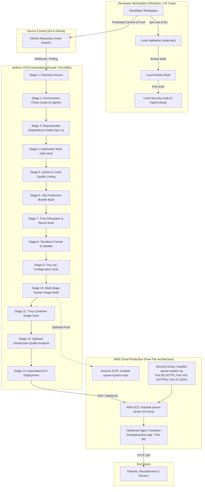
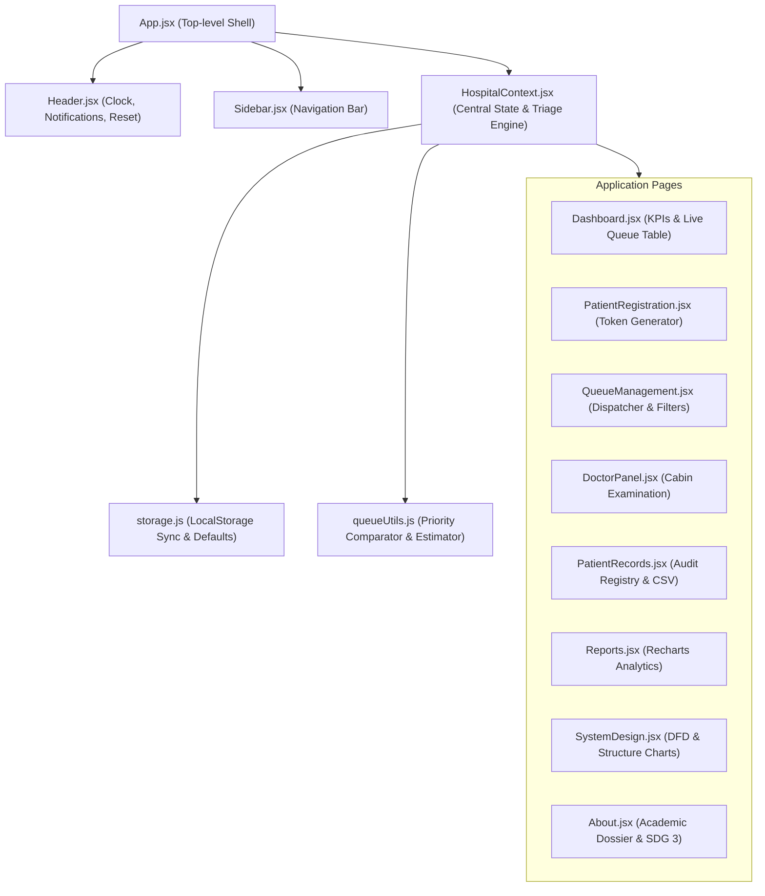

# System & DevSecOps Architecture
## Hospital Queue Management System

This document outlines the end-to-end architecture of the **Hospital Queue Management System (HQMS)**, covering the application component model, local DevSecOps development environment, CI/CD pipeline execution flow, and AWS cloud deployment topology.

---

## 1. High-Level DevSecOps Pipeline Flow

The following diagram illustrates the complete DevSecOps lifecycle from developer commit to AWS EC2 production deployment:

---

## 2. Application Component Architecture

The frontend is built with React 18 and Vite 6, using functional components and centralized state managed via React Context.

### Core Logic Modules:
- **`queueUtils.js`**:
  - Implements multi-tier priority queue sorting: `Emergency` (Weight 3) > `High` (Weight 2) > `Normal` (Weight 1).
  - Uses First-Come First-Served (FIFO) ordering based on registration ISO timestamp for patients within identical tiers.
  - Generates monotonic sequential Token identifiers (`T001`, `T002`, `T013`...) and Patient IDs (`P001`...).
  - Calculates dynamic estimated waiting times factoring in priority, cabin doctor allocation, and queue depth.
- **`HospitalContext.jsx`**:
  - Manages queue lifecycle state transitions: `Waiting` &rarr; `Called` &rarr; `In Consultation` &rarr; `Completed` (or `Cancelled`).
  - Broadcasts non-blocking toast notifications and audit log events.
- **`storage.js`**:
  - Transparently persists patient queue state to browser `localStorage` under `hqms_hospital_patients_v1`.
  - Provides a single-click reset function to restore pristine seed records for academic viva demonstration.

---

## 3. Containerization Architecture (Docker)

The production container uses a hardened multi-stage Docker build:

1. **Build Stage (`node:22-alpine`)**:
   - Compiles React + Vite JSX assets into minified JavaScript and CSS.
   - Executes automated tests (`npm test`) as a mandatory build prerequisite.
2. **Production Stage (`nginx:1.27-alpine`)**:
   - Executes `apk update && apk upgrade` to patch all base OS packages against known CVEs.
   - Incorporates custom `nginx.conf` with security headers (`X-Frame-Options`, `X-Content-Type-Options`, `X-XSS-Protection`).
   - Configures Gzip compression and client-side single page app routing (`try_files $uri $uri/ /index.html`).
   - Implements native healthcheck endpoint (`/health` &rarr; HTTP 200 `healthy`).
   - Runs worker processes dropped to unprivileged `nginx` user.

---

## 4. Infrastructure as Code (Terraform)

The cloud infrastructure is defined declaratively using Terraform:

- **Provider**: AWS Provider v5.x with automatic default resource tagging.
- **Compute**: Single EC2 instance named `hospital-queue-server` (`t2.micro`, Ubuntu 24.04 LTS).
  - Configured with `prevent_destroy = false` and lifecycle protection (`ignore_changes`) to safeguard the existing server from unintended destruction.
  - Configured with IMDSv2 session tokens (`http_tokens = "required"`).
- **Network Security**: Security group `hospital-queue-system-sg` enforcing least privilege:
  - Ingress Port 80 (HTTP) for public patient and hospital staff access.
  - Ingress Port 443 (HTTPS) for TLS traffic.
  - Ingress Port 22 (SSH) restricted to authorized administrator CIDR.
  - Strictly prevents exposure of Jenkins (8081), SonarQube (9000), or Docker daemon.
- **Container Registry**: Amazon ECR repository `hospital-queue-system-repo` with image immutability and scan-on-push enabled.
